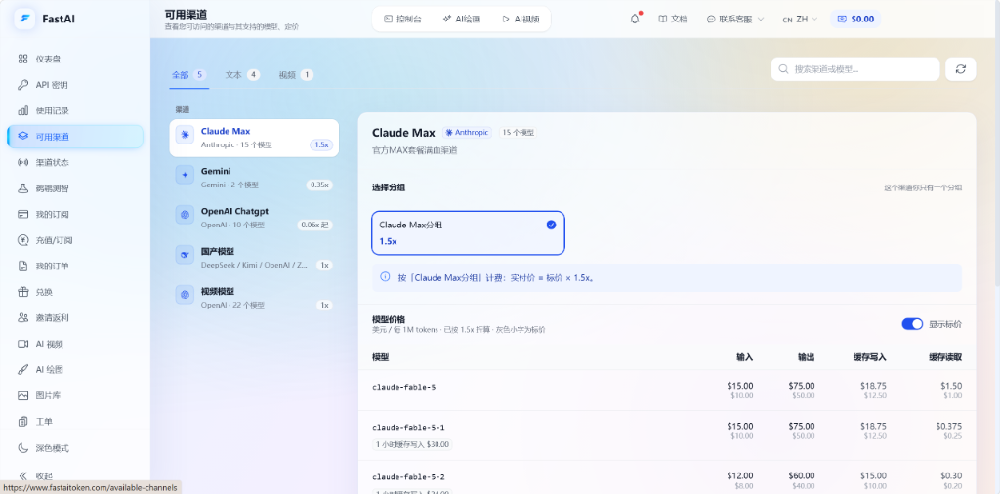

# 🚀 2026 稳定高性价比大模型 API 中转推荐 | Claude Max 满血 / OpenAI ChatGPT / Gemini / DeepSeek 聚合接口指南

[](LICENSE)
[](https://github.com/zhaoyang51/claude-openai-gemini-api-zhongzhuan)
[](https://www.fastaitoken.com/register?aff=RKTRQBP2JV67)

专为开发者、AI 编程工具用户与科研/办公人群整理的高性价比 **大模型 API 中转聚合平台（FastAI）** 评测与接入指南。全面支持 **Claude Max 官方满血渠道**、**OpenAI ChatGPT（低至 0.06x 倍率起）**、**Google Gemini（0.35x）**、**DeepSeek / Kimi 等国产大模型（1x）** 以及 **AI 视频模型（1x）**，完美兼容 **Claude Code、Cursor、Cline、Roo Code、Codex CLI、Cherry Studio、Open WebUI、NextChat** 等主流客户端与 Agent 框架。

> [!TIP]
> 🔗 **FastAI 官方注册入口**：  
> 👉 **[https://www.fastaitoken.com/register?aff=RKTRQBP2JV67](https://www.fastaitoken.com/register?aff=RKTRQBP2JV67)**

---

## 📌 挑选大模型 API 中转平台的常见痛点

很多用户在寻找 **Claude API / OpenAI API / Gemini API 中转站** 时，经常遇到以下问题：

| 常见痛点 | 实际影响 | FastAI 的解决方案 |
| :--- | :--- | :--- |
| **模型掺假 / 暗中降智** | 写代码能力骤降，复杂指令频繁出错，难以分辨是否真模型 | 独家内置 **「鹈鹕测智」**，定时让各分组模型跑同一道绘图编程题并公开作品与耗时 |
| **高倍率溢价 / 计费不透明** | 实际扣费远超官方原价，缓存命中也不减免费用 | 支持一键开启 **「显示标价」** 对照官方价；Claude Max 完整支持 **Prompt Cache** 低价读取 |
| **渠道单一 / 频繁切换站点** | 文本、代码、图像、视频模型分散在不同平台，管理繁琐 | 聚合 Anthropic、OpenAI、Gemini、国产模型与 22 个视频模型，内置 AI 绘图/视频工作台 |
| **低频或高频成本失衡** | 轻度问答嫌贵，高频批量脚本又烧不起 Token | 提供官方满血（`1.5x`）与限时超低倍率分组（`0.06x 起` / `0.2x` / `0.25x` / `0.3x` / `0.35x`） |

---

## ✨ 平台核心亮点

1. **🦢 独家「鹈鹕测智」定时真伪实测 —— 拒绝降智与套壳**
   - 平台定时让各分组的模型完成同一道 **HTML/SVG 动画绘图测试题**，直接展示生成的作品画面与实际耗时（每组保留最近 20 张作品，超过 7 天自动清理）。
   - 用之前点开看一眼即可直观对比各分组的真实代码与视觉生成水平，公开透明，不怕踩坑。
2. **💎 渠道分级清晰，兼顾“官方满血”与“极致低倍率”**
   - **Claude Max 官方满血渠道（1.5x）**：基于官方 MAX 套餐直连，包含 15 个模型，完整支持 **Prompt Caching（缓存写入 / 1 小时缓存写入 / 缓存读取）**，非常适合 **Claude Code、Cursor、Cline** 等高频读取长上下文的编程 Agent。
   - **OpenAI ChatGPT 渠道（低至 0.06x 起）**：涵盖 10 个模型及多种限时低倍率分组（如 `0.2x` 普通分组、`0.25x` 备用渠道、`0.3x` Pro 线路等），大幅压低日常对话、代码补全与批量处理成本。
   - **Gemini 渠道（0.35x）**：超低倍率接入 Google Gemini 系列模型。
   - **国产模型（1x） & 视频模型（1x）**：统一接口调用 DeepSeek、Kimi 等热门国产模型，并提供 22 个视频生成模型。
3. **📊 透明定价与可视化控制台**
   - 可用渠道页直接列出输入、输出、缓存写入、缓存读取的每 1M tokens 美元单价，并可对比官方标价。
   - 后台配备 **仪表盘、API 密钥管理、使用记录、渠道状态监控、按量充值/订阅、兑换码、工单客服** 以及 **中英文/深色模式切换**。
4. **🎨 开箱即用的 AI 绘图与 AI 视频工作台**
   - 除了面向开发者的标准 API 接口，官网控制台还内置了 **AI 绘图**、**AI 视频** 与 **图片库**，无需写代码也能直接在线创作。

---

## 🖼️ 平台实拍预览

### 1. 鹈鹕测智（各分组模型真实能力定时对比）


### 2. 可用渠道与透明定价（支持标价与实付价对照）



---

## 📋 可用渠道与倍率一览

| 渠道名称 | 模型系列 | 模型数量 | 计费倍率 | 适用场景与特点 |
| :--- | :--- | :---: | :---: | :--- |
| **Claude Max** | Anthropic | 15 个模型 | `1.5x` | 官方 MAX 套餐满血直连，支持 Prompt Cache（含 1 小时缓存写入与低价缓存读取），适配 Claude Code / Cursor |
| **Gemini** | Google Gemini | 2 个模型 | `0.35x` | 超低倍率高性价比文本与多模态通道 |
| **OpenAI Chatgpt** | OpenAI | 10 个模型 | `0.06x 起` | 覆盖低至 `0.06x` 起及 `0.2x` / `0.25x` / `0.3x` 限时低倍率分组，高频调用首选 |
| **国产模型** | DeepSeek / Kimi 等 | 多模型 | `1x` | 国内主流开源与商业模型统一 OpenAI 格式调用 |
| **视频模型** | OpenAI 等 | 22 个模型 | `1x` | 丰富视频生成模型，支持控制台在线生成与素材管理 |

> 注：实时模型列表、限时低倍率分组与具体定价以登录后 [可用渠道页面](https://www.fastaitoken.com/available-channels) 展示为准。

---

## 🚀 3 分钟快速接入指南

### 第一步：注册账号并获取 API Key

1. 打开 FastAI 官网完成注册：**[https://www.fastaitoken.com/register?aff=RKTRQBP2JV67](https://www.fastaitoken.com/register?aff=RKTRQBP2JV67)**
2. 登录后在左侧菜单进入 **「可用渠道」** 或 **「鹈鹕测智」**，按需选择对应分组（例如 Claude Max、OpenAI 低倍率分组或 Gemini）。
3. 进入 **「API 密钥」** 页面创建一个新的密钥（`sk-...`），并完成充值或订阅即可开始调用。

### 第二步：在主流 AI 客户端中配置

FastAI 完全兼容 OpenAI API 协议格式，直接填入以下参数即可使用：

- **API Base URL / 接口地址**：`https://www.fastaitoken.com/v1`
- **API Key**：控制台生成的 `sk-...` 密钥

常见支持工具：
- **AI 编程 / Agent**：Claude Code、Cursor、Cline、Roo Code、Codex CLI、OpenCode、Windsurf
- **桌面 / Web 聊天客户端**：Cherry Studio、ChatBox、NextChat、Open WebUI、LobeChat
- **开发与自动化工作流**：LangChain、LlamaIndex、Dify、n8n、FastGPT

### 第三步：代码调用示例

#### 1. cURL 命令行测试

```bash
curl https://www.fastaitoken.com/v1/chat/completions \
  -H "Content-Type: application/json" \
  -H "Authorization: Bearer YOUR_FASTAI_API_KEY" \
  -d '{
    "model": "gpt-6.1-sol",
    "messages": [
      {"role": "user", "content": "你好，请用一句话介绍你自己。"}
    ]
  }'
```

#### 2. Python（OpenAI 官方 SDK）

完整可运行示例见 [`examples/quickstart.py`](./examples/quickstart.py)：

```python
import os
from openai import OpenAI

client = OpenAI(
    api_key=os.environ.get("FASTAI_API_KEY"),
    base_url="https://www.fastaitoken.com/v1",
)

response = client.chat.completions.create(
    model="gpt-6.1-sol",  # 可替换为可用渠道中的任意模型名
    messages=[
        {"role": "system", "content": "You are a helpful assistant."},
        {"role": "user", "content": "请帮我写一个 Python 快速排序函数。"},
    ],
)

print(response.choices[0].message.content)
```

---

## 💡 省钱与选型建议

1. **AI 编程与长上下文 Agent（Claude Code / Cline / Cursor）**：优先选用 **Claude Max** 渠道，开启 Prompt Caching 后，重复的系统提示词与项目代码上下文读取单价极低，长期开发成本比普通无缓存渠道低得多。
2. **高频问答 / 自动化脚本 / 翻译批处理**：优先关注 **OpenAI Chatgpt**（`0.06x 起`及 `0.2x / 0.25x / 0.3x` 限时分组）与 **Gemini**（`0.35x`），使用前可先在 **「鹈鹕测智」** 查看该分组近期作品质量，兼顾极低单价与可用性。
3. **稳定性监控与排查**：如果某条线路偶发延迟，可在左侧 **「渠道状态」** 实时查看健康度，并在 **「使用记录」** 中核对每次请求的 Token 消耗与耗时。

---

## 🔗 常用入口

- **FastAI 官方注册入口**：[https://www.fastaitoken.com/register?aff=RKTRQBP2JV67](https://www.fastaitoken.com/register?aff=RKTRQBP2JV67)
- **FastAI 可用渠道列表**：[https://www.fastaitoken.com/available-channels](https://www.fastaitoken.com/available-channels)

---

## 📄 免责声明

本仓库仅用于大模型 API 中转平台的功能整理、接入教程与开发测试示例分享。实时模型列表、倍率活动与价格以平台官网页面为准，请合理合规使用相关服务。
